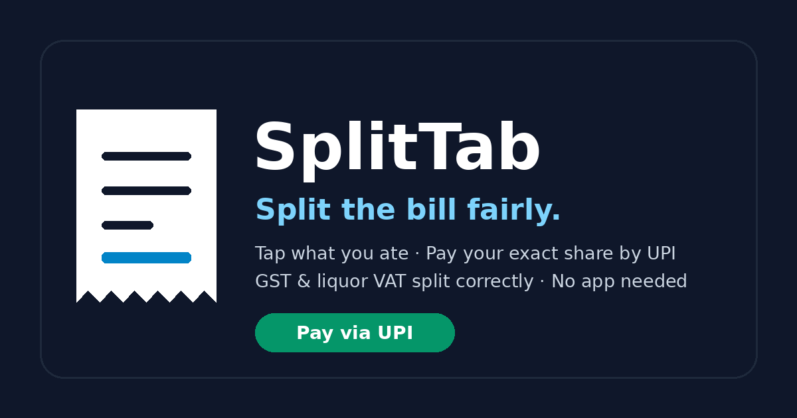
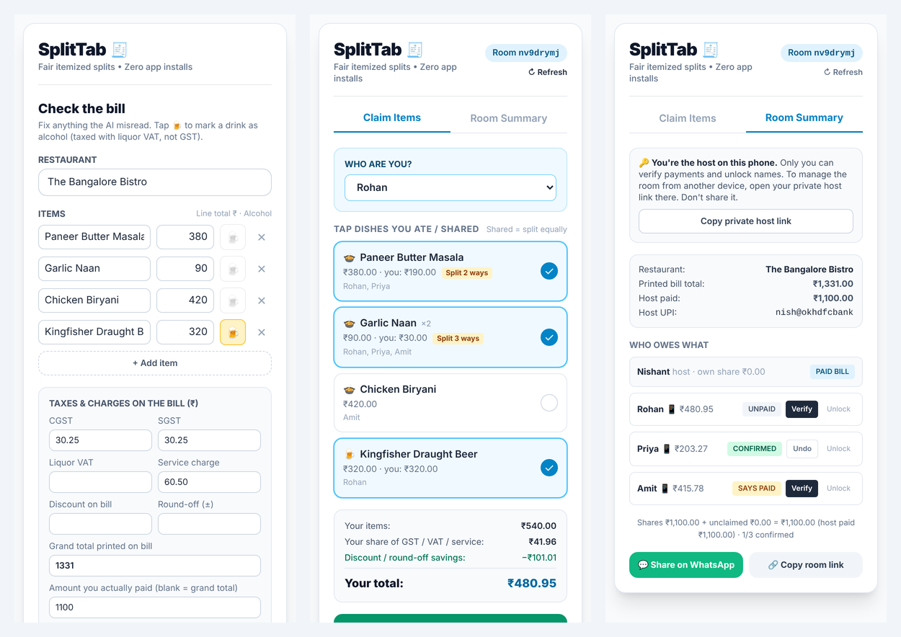
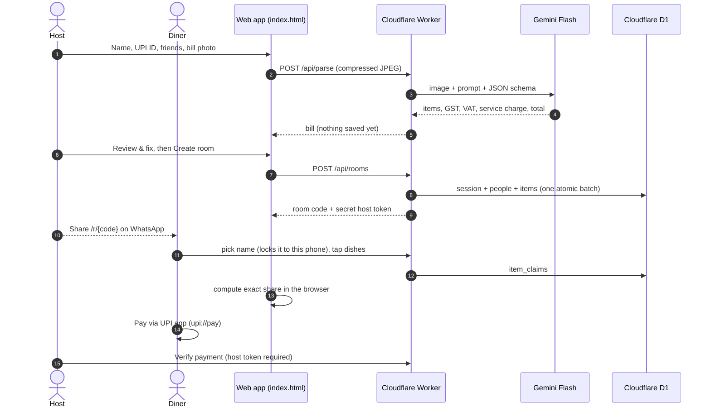

<p align="center">
  
</p>

<p align="center">
  <b>Fair, itemized restaurant bill splits for India: photo in, exact UPI payments out. No app, no login.</b>
</p>

<p align="center">
  <a href="https://splittab.splittabsubdomain.workers.dev"></a>
  <a href="https://github.com/arkhamknight147/splittab/actions/workflows/ci.yml"></a>
  
  
  <a href="LICENSE"></a>
</p>

<p align="center">
  <a href="https://splittab.splittabsubdomain.workers.dev"><b>Try it live</b></a> ·
  <a href="docs/PRD.md">PRD</a> ·
  <a href="docs/ARCHITECTURE.md">Architecture & maths</a> ·
  <a href="docs/TDD.md">Technical design</a> ·
  <a href="CHANGELOG.md">Changelog</a>
</p>

<p align="center">
  ✅ <b>Validated end-to-end with a real UPI payment</b>: bill scanned, dishes claimed and the exact share paid from a friend's phone into the host's UPI account.
</p>

<p align="center">
  
</p>

## Contents

- [Why SplitTab](#why-splittab)
- [Features](#features)
- [How it works](#how-it-works)
- [Tech stack](#tech-stack)
- [Getting started](#getting-started)
- [Configuration](#configuration)
- [Deployment](#deployment)
- [Project structure](#project-structure)
- [Security & privacy](#security--privacy)
- [Product decisions](#product-decisions)
- [Roadmap & known limitations](#roadmap--known-limitations)
- [Troubleshooting](#troubleshooting)
- [Contributing](#contributing) · [License](#license)

## Why SplitTab

Splitting a restaurant bill in India is harder than it looks:

- **Equal splits are unfair.** Non-drinkers subsidise beer, and the person who only had a starter pays for the biryani.
- **Taxes don't split evenly.** Food carries 5% GST (CGST + SGST); alcohol carries state liquor VAT instead. Service charge and Zomato Gold / card discounts cut across both.
- **Split apps need everyone to install and sign up.** At the table, nobody does, so the host pays and chases friends on WhatsApp for days.

SplitTab turns a photo of the bill into a shared room where each person taps what they ate and pays their exact share with one UPI tap. The full flow has been tested on real phones with a real UPI transfer, not just in simulated browsers.

## Features

- **Scan the bill**: Gemini Flash reads items, quantities, GST, liquor VAT, service charge and the printed total into structured JSON.
- **Review before sharing**: the host fixes misreads, marks drinks as alcohol, and sees whether items + taxes match the printed total.
- **Tap what you ate**: shared dishes split equally among everyone who claims them.
- **Fair tax maths**: liquor VAT only on alcohol, GST on food, service charge and discounts shared proportionally. Shares always add up to what the host paid, to the paisa.
- **1-tap UPI**: opens GPay / PhonePe / Paytm with the exact amount; a "Copy UPI ID" fallback always works.
- **Host controls**: only the host can verify payments; each name is locked to one phone; a private host link works on a second device.
- **Zero install, ₹0 to run**: one HTML file, one Cloudflare Worker, one D1 database, all on free tiers.

## How it works



**The maths in one line:** each person pays `δ × (their food × M_food + their drinks × M_liq)`, where `M_food` adds GST and the food share of service charge, `M_liq` adds liquor VAT and the drinks' share of service charge, and `δ` scales everything to what the host actually paid. Full derivation and a worked example (₹480.95 / ₹203.27 / ₹415.78 = ₹1,100.00) in [ARCHITECTURE.md](docs/ARCHITECTURE.md#4-mathematical-domain-model--tax-splitting-logic).

## Tech stack

| Layer | Choice | Why |
|---|---|---|
| Frontend | Single `index.html`, vanilla JS, pre-built Tailwind CSS | Opens instantly inside WhatsApp's browser; nothing to install |
| API & hosting | Cloudflare Workers (static assets + JSON API) | Free 100k requests/day, keeps the Gemini key server-side, one deploy command |
| Database | Cloudflare D1 (SQLite) | Relational data (rooms, people, items, claims); doesn't pause when idle |
| Receipt AI | Google Gemini Flash with structured output | Reads crumpled thermal bills and classifies alcohol vs food in one call |
| Payments | NPCI UPI intent links | No payment gateway; SplitTab never holds money |

## Getting started

### Prerequisites

- Node.js 22+ (`node -v`), required by wrangler 4
- Optional: Python 3 + `pip install playwright pillow` and `playwright install chromium` for the browser tests

### Run locally (no API key needed)

```bash
git clone https://github.com/arkhamknight147/splittab.git
cd splittab
npm install
npm run db:local      # create local D1 tables
npm run dev:mock      # http://localhost:8787 with a built-in sample bill instead of Gemini
```

### Use the real Gemini locally

```bash
cp .dev.vars.example .dev.vars    # then put your key in it: GEMINI_API_KEY=AIza...
npm run dev
```

Get a free key at [aistudio.google.com/apikey](https://aistudio.google.com/apikey).

### Tests

| Command | What it checks | Needs |
|---|---|---|
| `npm test` | Split engine: case study, discounts, VAT isolation, rounding | Node only |
| `python tests/api_test.py` | Host token, name locks, payment permissions, rate limit (22 checks) | `npm run dev:mock` running |
| `python tests/e2e.py` | Host + 3 diners + intruder phone in real browsers (23 checks) | `npm run dev:mock` + Playwright |

CI runs the unit tests, checks `app.css` is up to date, and dry-runs the Worker build on every push.

## Configuration

Set in `wrangler.toml` under `[vars]`, except the API key, which is a secret.

| Name | Default | Purpose |
|---|---|---|
| `GEMINI_API_KEY` (secret) | — | Google AI Studio key: `npx wrangler secret put GEMINI_API_KEY` |
| `GEMINI_MODEL` | `gemini-3.6-flash` | Primary receipt model |
| `GEMINI_FALLBACK_MODEL` | `gemini-3.1-flash-lite` | Used if the primary is retired, busy or over quota |
| `PARSE_LIMIT_PER_MINUTE` | `6` | Scans per IP per minute |
| `PARSE_LIMIT_PER_DAY` | `300` | Scans per day across the app (protects the Gemini quota) |
| `ROOM_LIMIT_PER_MINUTE` / `ROOM_LIMIT_PER_DAY` | `5` / `500` | Rooms created per IP per minute / per day (protects the D1 write quota) |
| `WRITE_BURST_PER_MINUTE` | `120` | Best-effort cap on API writes per IP per minute |
| `ROOM_TTL_DAYS` | `30` | Rooms are deleted after this many days |
| `GEMINI_MOCK` | `0` | `1` returns the sample bill (used by `npm run dev:mock`) |

**Styling:** `public/app.css` is generated from the classes used in `index.html`. After changing classes, run `npm run css` and commit the result. Deploying needs no build step.

## Deployment

**First time** (free Cloudflare account, no card needed):

```bash
npx wrangler login
npx wrangler d1 create splittab   # paste the database_id into wrangler.toml, keep binding = "DB"
npm run db:remote                 # create tables in production
npm run deploy
npx wrangler secret put GEMINI_API_KEY
```

The app is then live at `https://splittab.<your-subdomain>.workers.dev`.

**Updates:** `npm run db:remote` (applies any new migrations; do this first), then `npm run deploy`. Logs are in the Cloudflare dashboard under **Workers & Pages → splittab → Logs**.

## Project structure

```text
splittab/
├── .github/workflows/ci.yml   CI: unit tests, CSS check, Worker dry-run
├── docs/                      PRD, TDD, ARCHITECTURE (Markdown) + images
├── migrations/                D1 schema, applied in order by wrangler
├── public/                    Static site: index.html, app.css, og.png, icons
├── src/
│   ├── worker.js              API, auth, rate limit, daily clean-up cron
│   └── styles/tailwind.css    Tailwind source for public/app.css
├── tests/                     math.test.mjs, api_test.py, e2e.py
├── CHANGELOG.md
├── package.json               wrangler + Tailwind CLI scripts (no bundler)
└── wrangler.toml              Worker, D1 binding, vars, logs, cron
```

API reference: [TDD §6.1](docs/TDD.md#61-api-contract).

## Security & privacy

- No secrets in the browser. The Gemini key is a Worker secret; the database is reachable only through the Worker.
- Room links are unguessable 8-character codes. Host and per-phone tokens decide who can verify, unlock or claim; only their SHA-256 hashes are stored.
- All receipt and user text is HTML-escaped before display; every write is checked against the room it belongs to.
- Only first names and the host's UPI ID are stored. Receipt photos are never stored. Rooms are deleted after 30 days.
- Security headers on every page: a Content-Security-Policy that blocks third-party scripts and outbound requests, plus no framing (clickjacking), `nosniff` and `no-referrer`.
- Abuse limits: scans and room creation are rate-limited per IP and per day (stored in D1), and all API writes have a per-IP flood guard.
- On Gemini's free tier, Google may use submitted images to improve its products. Use a paid key for a public launch.

Found a vulnerability? See [SECURITY.md](SECURITY.md).

## Product decisions

| Decision | Trade-off accepted |
|---|---|
| Host reviews the AI output before anyone sees it | One extra screen, in exchange for numbers friends trust |
| Scale every share by `paid ÷ computed total` | Simple and exact to the paisa; discounts are shared pro rata, not per item |
| Tax buckets (food GST vs liquor VAT) instead of per-item tax | Matches how Indian bills print taxes; needs correct alcohol flags (the Review screen warns) |
| Tokens instead of accounts | Zero sign-up; losing the host phone without the host link loses host control for that room |
| Pull-based sync (on tap, refresh, page focus) instead of WebSockets | No always-on connections to pay for; others' taps appear a moment later |
| Code (one Worker) instead of no-code (Make.com) | A deploy per change, in exchange for ordering guarantees, validation and no credit caps |

## Roadmap & known limitations

- [ ] Split unclaimed items in one tap (today the host can claim them on someone's behalf)
- [ ] Live updates across phones (Durable Objects WebSockets)
- [ ] Host recovery without the private host link
- [ ] State-specific liquor tax rules in the parsing prompt
- [ ] Automatic payment reconciliation (UPI / Account Aggregator webhooks)

Also note: some UPI apps restrict payments started from `upi://` links ("Copy UPI ID" is the fallback), and `og:image` in `index.html` is an absolute URL to update if you change domains.

## Troubleshooting

<details>
<summary>Common errors and fixes</summary>

| Symptom | Cause | Fix |
|---|---|---|
| `API key not valid` | `.dev.vars` not saved, or wrong key | Save `.dev.vars` (`GEMINI_API_KEY=AIza…`, no quotes); in production run `npx wrangler secret put GEMINI_API_KEY` |
| `no such table: sessions` | Migrations not applied | `npm run db:local` (local) or `npm run db:remote` (production). Local data resets when `database_id` changes |
| `Cannot read properties of undefined (reading 'prepare')` | D1 binding isn't named `DB` | Set `binding = "DB"` in `wrangler.toml` and redeploy |
| "Couldn't read the bill right now" | Gemini model retired or quota used up | Check the Worker logs; update the model names in `wrangler.toml` |
| "Too many scans…" | Rate limit | Wait a minute, or raise `PARSE_LIMIT_PER_MINUTE` / `PARSE_LIMIT_PER_DAY` |
| "…already in use on another phone" | Name locked to someone's phone | Host taps **Unlock** next to the name in Room Summary |
| Page looks unstyled after editing `index.html` | New Tailwind classes not compiled | `npm run css` |
| `running scripts is disabled` (Windows) | PowerShell policy | `Set-ExecutionPolicy -Scope CurrentUser RemoteSigned` |

</details>

## Contributing

Issues and pull requests are welcome. Please run `npm test` (and ideally `tests/api_test.py`) before opening a PR, and `npm run css` if you changed any classes in `index.html`.

## License

[MIT](LICENSE) © Nishant

Built by **Nishant**, Senior Product Manager · [GitHub](https://github.com/arkhamknight147)
